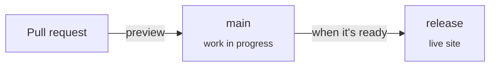

  <picture>
    <source media="(prefers-color-scheme: dark)" srcset="docs/logo-dark.png">
    
  </picture>

  <strong>The Octoply website</strong> 
  A coordination company. We originate ideas and develop them until they can stand on their own.

---

A static site: plain HTML, CSS and JavaScript, with no framework and no build
step. It's hosted on Netlify, and the jobs and contact forms use Netlify Forms.

## Branches

| Branch | Use it for | Where it deploys |
| --- | --- | --- |
| `main` | Everyday changes. Open pull requests against it. | `main--<site>.netlify.app` |
| Pull requests | Trying a change before it goes into `main` | `deploy-preview-<number>--<site>.netlify.app`, linked on the PR |
| `release` | The live site | Production |

**To release:** check the change on the `main` preview, then open a pull
request from `main` into `release` and merge it.

## What's where

| Path | Contents |
| --- | --- |
| [`site/`](site) | The website: one folder per page, with shared CSS, JS, fonts and images in `site/assets/` |
| [`netlify.toml`](netlify.toml) | Where Netlify publishes from, redirects from old addresses, security and cache headers |
| [`docs/static-site.md`](docs/static-site.md) | How the site is put together, deploy setup and the launch checklist |

## Making a change

1. Edit the files in `site/`. Every page is plain HTML, so open it in a
   browser to check your change.
2. If you change `site.css`, `site.js` or `apply.js`, update the `?v=` number
   where the page links to the file, so browsers fetch the new version.
3. Push to a branch and open a pull request into `main`. The preview link
   appears on the pull request within a minute or two.

## Deploying

Netlify deploys straight from this repository: `release` goes live, `main` and
pull requests get preview addresses. There's no GitHub Actions workflow and no
token to look after. Setup steps are in
[`docs/static-site.md`](docs/static-site.md#deploying).
